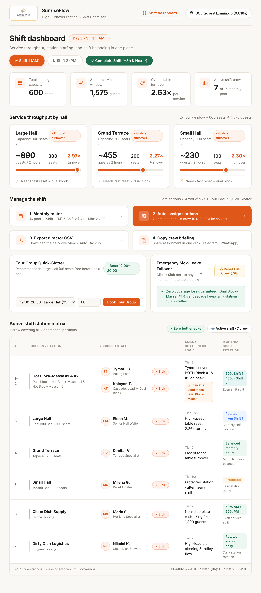

# SunriseFlow (v1.6)

Shift scheduling and station allocation tool built for **Sunrise River Beach Resort** (Bulgaria).

I wrote this project after working as an Acting Shift Lead managing buffet operations across 3 dining halls (**600 seats**, **~1,300 guests per 2-hour peak window**, **$2.17\times$ table turnover**). Previously, building monthly rosters and rebalancing 7 stations when someone called in sick was done on paper and took ~45 minutes per shift.



## What It Solves

1. **30-Day Monthly Roster (`14 S1 / 14 S2 / 2 OFF`):**
   - Generates a monthly schedule for all 16 staff members across **8-hour shifts**.
   - Enforces a strict cap of 2 days off (`OFF`) per person (respecting pre-requested dates in `staff_exceptions`) and splits the remaining 28 working shifts 50/50 between Morning (`S1`) and Evening (`S2`).
2. **Daily 7-Station Allocator:**
   - Assigns 7–8 active shift crew across all 7 stations (`Hot Block-Massa #1 & #2`, `Large Hall`, `Grand Terrace`, `Small Hall`, `Clean Dish Supply`, `Dirty Dish Logistics`).
   - Prevents assigning the same steward to `Dirty Dish Logistics` two days in a row and routes staff with high accumulated weekly hours to the lower-load `Small Hall` (100 seats).
3. **Tour Group Slotter & Capacity Check:**
   - Checks available seats per hourly window before booking incoming tour buses (20–100 guests) and updates 2-hour guest flow and turnover metrics in SQLite.
4. **Sick-Leave Failover (`Dual Block-Massa`):**
   - If a crew member calls in sick (`SICK_LEAVE`), the Acting Shift Lead (`dual_block_capable = 1`) covers both hot buffet lines (#1 and #2), freeing a waiter to cover the open hall station.
5. **Executive Director CSV Reporting (Utility Score & Henry Gantt Timeline):**
   - Exports a 3-section analytical CSV report featuring station-level Efficiency / Utility Scores (KKD $\%$), a 16-hour horizontal Henry Gantt timeline (`06:00–22:00`), and an automated audit log of `staff_exceptions`.

## Database Schema (9 Tables in SQLite)

Defined in `schema.sql` and initialized via `database.py`:
- `staff` — 16 crew records, experience tiers, `dual_block_capable` flag, and shift counters
- `stations` — 7 operational stations with capacity and difficulty weights
- `hall_metrics` — live seating capacity and 2-hour guest flow for the 3 dining halls
- `zone_time_slots` — hourly capacity buckets for tour group reservations
- `staff_exceptions` — `REQUESTED_OFF` and `SICK_LEAVE` records
- `monthly_schedule` — 30-day S1/S2/OFF matrix (480 rows per month)
- `daily_roster` — station-level assignments and rotation notes per shift
- `tour_groups` — logged group arrivals and assigned waiters
- `system_state` — active day and shift pointer (`S1` / `S2`)

## Director CSV Analytics: Utility Score (KKD) & Henry Gantt Timeline

When exporting the daily shift report (`GET /api/export-csv` or clicking **3. Export director CSV**), `SunriseFlow` generates a multi-section executive CSV report without cluttering the operational web UI:

### 1. Efficiency & Staff Utility Score ($\eta$ / KKD)
Each station assignment is evaluated against real-time 2-hour hall guest flow (`hall_metrics`), station difficulty weight ($1..3$), and staff experience tier ($\text{Tier } 1..3$) across an **8-hour shift**:

- **Zone Utilization Efficiency ($\eta_{\text{zone}}$):**
  $$\eta_{\text{zone}} = \left(\frac{\text{Current 2h Guest Flow}}{\text{Seating Capacity} \times 2.0}\right) \times 100\%$$
- **Throughput per Labor Hour ($P_{\text{hour}}$):**
  $$P_{\text{hour}} = \frac{\text{Total Guests in Window}}{\text{Active Crew} \times 8\text{h}}$$
- **Station Utility Score ($U_{\text{staff}}$):** Incorporates tier weighting and awards a **$+16.5\%$ Dual-Block Cascade bonus** when the Acting Shift Lead (`dual_block_capable = 1`) simultaneously covers both `Hot Block-Massa #1 & #2` during a sick-leave failover ($+1\text{ FTE}$ saved).

### 2. Embedded Henry Gantt Operational Timeline (`06:00–22:00`)
Section 2 of the exported CSV renders an 8-bucket horizontal Gantt matrix (`06:00` to `22:00` in 2-hour intervals using `[████████]` active and `[░░░░░░░░]` standby blocks) with 30-minute precision:
- **8-Hour Shift Rosters:** Visualizes `Shift 1 (AM) 06:00–14:00` and `Shift 2 (PM) 14:00–22:00` alongside active crew coverage and shift KKD.
- **Tour Bus Arrival Windows (`zone_time_slots`):** Maps exact arrival bars (`12:30–13:30`, `13:30–14:30`, `17:00–18:00`, `18:00–19:00`, `19:00–20:00`), hall occupancy percentage, free seats, and peak status (`CRITICAL PEAK`, `HIGH FLOW`, or `OPTIMAL FREE SLOT`).

### 3. Managing Staff Exceptions in SQLite (`staff_exceptions`)
Section 3 of the CSV logs all active exceptions. The `staff_exceptions` table enforces two exception types via `CHECK(exception_type IN ('REQUESTED_OFF', 'SICK_LEAVE'))` for days $1..30$:

```sql
-- Pre-scheduled day off request (respects Max 2 OFF/month fairness constraint)
INSERT INTO staff_exceptions (staff_id, day_of_month, exception_type)
VALUES (4, 12, 'REQUESTED_OFF');

-- Emergency sick-leave (triggers automatic Dual Block-Massa #1 & #2 failover cascade)
INSERT INTO staff_exceptions (staff_id, day_of_month, exception_type)
VALUES (2, 1, 'SICK_LEAVE');
```

## Project Governance (RACI & Risk Log)

### RACI Matrix

| Process Step | Acting Shift Lead (Dev) | Senior Shift Lead & F&B Mgr | Crew Pool (16) | Resort Director |
| :--- | :---: | :---: | :---: | :---: |
| 1. Bottleneck & capacity mapping (600 seats / 1,300 guests) | **R / A** | C | C | I |
| 2. SQLite schema (9 tables) & Python allocation engine | **R / A** | I | - | I |
| 3. Web UI & tour group slot validation | **R / A** | C | I | - |
| 4. Monthly schedule generation (14 S1 / 14 S2 / 2 OFF) | **R** | **A / C** | I | I |
| 5. Daily station rotation & sick-leave failover | **R / A** | **R / A** | **R** | I |
| 6. Daily CSV reporting (`exports/`) | **R** | C | I | **A** |

### Risk Register

| Risk | Prob (1-5) | Impact (1-5) | Score | Mitigation |
| :--- | :---: | :---: | :---: | :--- |
| **R1. Non-technical supervisor adoption** | 4 | 4 | **16** | Simple 4-action web dashboard + 1-click CSV export and text briefing. |
| **R2. Unplanned sick leave during peak window** | 3 | 5 | **15** | `dual_block_capable=1` failover merges Block-Massa #1 & #2 under Shift Lead. |
| **R3. Crew burnout on Dirty Dish station** | 4 | 3 | **12** | Daily rotation check queries yesterday's `daily_roster` before assigning Station #7. |
| **R4. Local Wi-Fi drop during service** | 2 | 5 | **10** | Zero-cloud local SQLite file (`rest1_main.db`) + automatic CSV backups. |

## Time Saved per Shift

| Workflow Step | Manual (Paper/Excel) | SunriseFlow | Saved |
| :--- | :---: | :---: | :---: |
| Checking weekly hours & fatigue across 16 staff | 12 min | 2 min | -10 min |
| Assigning 7 stations & checking yesterday's rotation | 18 min | 1 min | -17 min |
| Resolving shift balance questions & crew briefing | 10 min | 5 min | -5 min |
| Exporting daily summary for Resort Director | 10 min | 1 min | -9 min |
| **Total per shift** | **~45–50 min** | **~9–15 min** | **~36 min (-66.7%)** |

## Running Locally

Built with Python 3 standard library (`sqlite3`, `http.server`, `csv`, `unittest`) — no external pip packages required.

```bash
# Run unit tests (5 tests)
python test_shift_engine.py

# Start local web server on http://127.0.0.1:5000
python app.py
```
